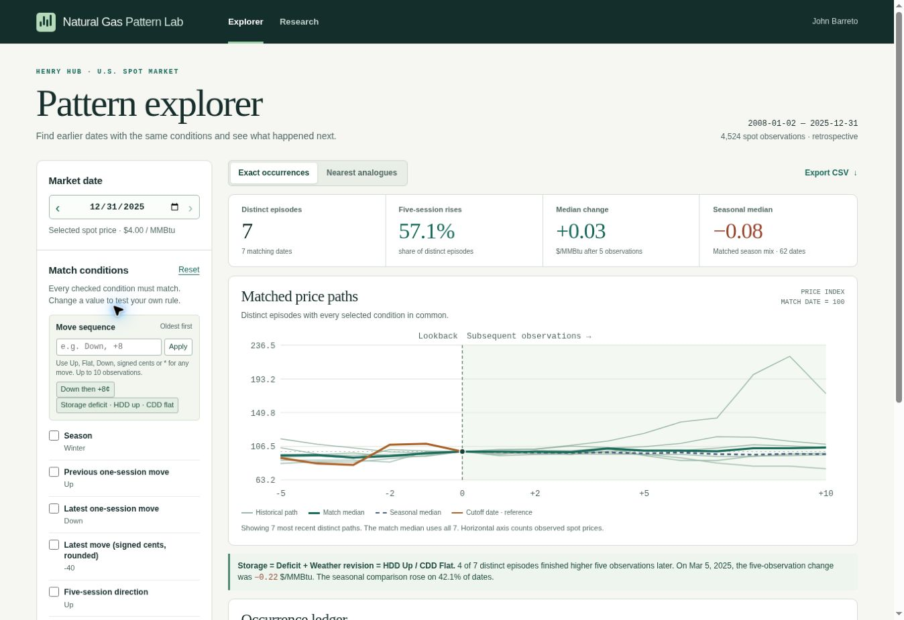

# Natural Gas Pattern Lab

**A down move followed by an 8-cent rise occurred 31 times in the bundled Henry Hub spot history.** After removing overlapping episodes, 27 remained. Five observations later, 14 had risen and 13 had fallen. The median change was **+$0.01/MMBtu**. The same two moves preceded a **+$0.50** change on April 3, 2008 and a **−$0.99** change on October 18, 2022. Those dates identify the end of the matching sequence.

An offline Python research tool by **John Barreto**. Define a sequence, find every completed historical occurrence, inspect the exceptions and compare its outcomes with a seasonal benchmark. The public dataset contains 4,524 U.S. Henry Hub **spot** observations from January 2008 through December 2025.



## Run the demo

Download and extract the repository. From the directory containing this README, use Python 3.10 or later.

```sh
python -m gaslab demo
```

The command opens the dashboard in your default browser. If the tab does not open automatically, visit **http://127.0.0.1:8765**. Press Ctrl+C in the terminal to stop it. On Windows you can double-click **start-windows.bat**. The demo runs locally using the bundled data and Python standard library. No API key or package installation is needed.

## Find an identical occurrence

1. Open **Explorer** and click **Down then +8¢**. Every matching date satisfies the same ordered two-step rule.
2. Change the sequence to `Down, +8, Up` to require three consecutive moves. Enter `Down, *, +8` to permit any one move between the two defined events. Direction labels compare signs. Signed integers compare changes rounded to the nearest cent per MMBtu. Sequences run from oldest to newest and accept up to ten moves.
3. Add a condition such as autumn, high volatility or a published storage deficit. All selected conditions must be true on the date the sequence ends. The date picker sets the historical cutoff. You can use its observed feature values or enter your own combination.
4. Inspect **Occurrence ledger**. Compare all matches with the nonoverlapping sample, filter to dates that fell and export the results. The CSV includes the date and dollar change at each of the 1-, 5- and 10-observation horizons.

```sh
python -m gaslab query --date 2025-12-31 --sequence "Down,+8" --csv matches.csv
python -m gaslab query --date 2025-12-31 --sequence "Down,*,+8" --fields season --where season=Autumn
```

“Identical” applies to the conditions you specify. Two qualifying dates can have very different gas prices, weather or inventory levels. Overlap is shown in the date ledger but removed from the headline sample. A candidate's full ten-observation outcome must have ended before the query date. The two-move example's nonoverlapping dates are at least 16 observations apart, covering five observations of lookback and ten of outcome. Longer sequences extend the separation. The seasonal comparison uses dates with the same required input coverage, weighted to the season mix of these distinct episodes.

You can run the same search with physical conditions. Choose **Storage deficit · HDD up · CDD flat** to find dates when inventory was below its five-year average, forecast heating degree days increased and forecast cooling degree days were unchanged. Seven nonoverlapping episodes qualified. Five spot observations later, four were higher and three lower. The change was **+$0.75/MMBtu** after February 5, 2025 and **−$0.22/MMBtu** after March 5, 2025. HDD and CDD refer to degree-day forecasts over identical valid dates. The weather archive samples one run pair per month and its missing dates reduce the eligible history.

```sh
python -m gaslab query --fields storage,weather --where storage=Deficit --where "weather=HDD Up / CDD Flat"
```

## Discover a pattern or test a forecast

**Research → Rule discovery** searches ten predefined combinations, including the previous and current move, trend, volatility, storage and weather. It ranks exact combinations using the first 70% of the history and shows what happened on the later 30%. Open a rule to read its sample size and counterexamples. A user-defined sequence query is a historical description. The holdout screen provides a separate test of whether an earlier relationship recurred.

Across 818 paired daily walk-forward origins, the default analogue forecast's mean absolute miss was **$0.259/MMBtu** versus **$0.246** for season alone. The difference was **+$0.012**, with a paired 95% interval of **+$0.003 to +$0.021**. Adding features did not improve this benchmark over the tested history.

**Nearest analogues** compares prices by degree of similarity. It uses recent dollar changes, trailing volatility, season and available storage. Each row lists the features that made it close and the largest difference. The comparison uses fixed weights, scales estimated from earlier observations and a maximum distance. As many as ten nonoverlapping episodes can qualify. Where sufficient data exist, the verified NOAA sample can also be included in the distance with `python -m gaslab demo --analogue-weather`. Weather remains available for exact rules in the default explorer.

**As-published monthly replay** measures what could have been known from ALFRED on the first Friday of each month. Across 82 scored decisions, the five-observation analogue forecast had a mean absolute error of **$0.489/MMBtu**, compared with **$0.482** for the same-season median. The paired difference was **+$0.007**, with a 95% block-bootstrap interval from **−$0.014 to +$0.029**. The study did not establish that analogues beat season alone. The daily explorer uses a frozen price history indexed by quote date. Those dates can precede EIA publication, so its walk-forward results are retrospective.

```sh
python -m gaslab research
python -m gaslab.vintage --date 2020-01-03
python -m gaslab.weekend examples/weekends_synthetic.csv
python -m unittest discover -s tests -v
```

For the January 3, 2020 as-published replay, the two most recent spot moves and the five-observation trend all pointed down. Six earlier monthly decisions had exactly that signature. Three subsequently rose. The command lists each match and its realized change.

## Investigate weekend futures gaps

The separate futures study asks whether a Sunday reopening above Friday's settlement continued through Monday's settlement for the **same delivery contract**. It excludes rollovers, holiday schedules and missing openings. Supply your own contract-level observations. The bundled example uses synthetic values to exercise the importer. Instructions, the CSV schema and the seasonal benchmark are in the [futures guide](docs/FUTURES.md).

## Data and methods

| Resource | What it contains |
|---|---|
| [Data notes](docs/DATA.md) | Sources, archives, licensing, timing, coverage and optional data-refresh commands |
| [Study design](docs/RESEARCH.md) | Train/holdout split, episode selection, seasonal benchmark and uncertainty interval |
| [Publication-date replay](docs/VINTAGES.md) | Dated ALFRED snapshots, the spot mark actually available and the forecast target |
| [Daily evaluation and discovery](reports/research.json) | Every forecast, realized error, tested rule and holdout event for the bundled configuration |
| [Monthly forecast scores](reports/vintage_scores.csv) | Each as-published decision, actual observation date, forecast and realized error |
| [Source manifest](data/manifest.json) | Frozen data coverage and integrity checks |

To use a local spot file, supply a CSV with the header `date,price`, ISO observation dates and numeric USD/MMBtu prices. Run `python -m gaslab demo --spot my_spot.csv`. Supplying a custom spot file also puts you in control of auxiliary inputs. Pass `--storage` or `--weather` explicitly if needed. To generate a matching research report for a different dataset or configuration, use `--reports private/reports` with both the `research` and `demo` commands. Keep licensed data and generated private results outside the public repository.

This is a standalone rebuild from the research brief. No original implementation was supplied or verified. The ordered move syntax, match weights, nonoverlap policy, discovery split and dated replay are choices made for this edition. The software is [MIT licensed](LICENSE). Data attribution and reuse terms are documented separately.
